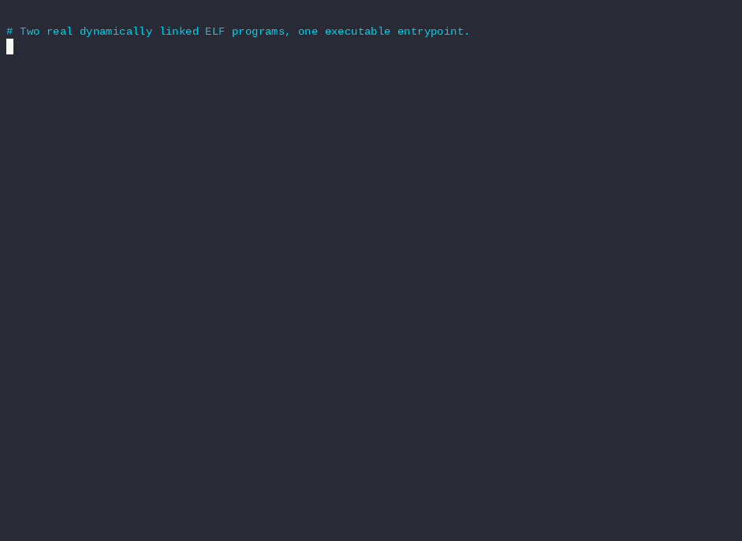
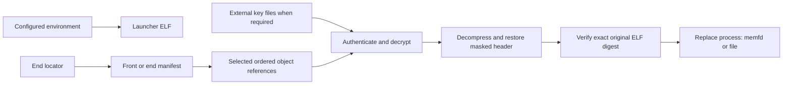

<p align="center">
  
</p>

<h1 align="center">fatelf</h1>

<p align="center">
  <strong>Many programs. One executable.</strong>
</p>

Build one Linux executable containing **one or more original ELF programs**.
A configurable environment variable chooses one payload per invocation. The
launcher reconstructs its exact bytes, verifies them, and replaces itself using
`execveat`. Dynamic programs use compatible host libraries and resources.

```sh
just release
./target/x86_64-unknown-linux-musl/release/fatelf pack \
  ls=/usr/bin/ls ps=/usr/bin/ps -o ./combined \
  --select-env FATELF_APP --order shuffled --shuffle-payload ps --seed 42
FATELF_APP=ls ./combined -1
FATELF_APP=ps ./combined -p 1 -o pid,comm
```

Both embedded ELF headers are always obscured. The outer launcher keeps its
normal ELF header. This example leaves `ls`'s body plain and ordered and shuffles
only `ps`. The default selection is the first label, `ls`. Unknown or empty
explicit selections fail. Add `--compression lz4` to compress eligible objects,
or `--manifest-position front` to move metadata immediately after the launcher.

## See ls and ps share one entrypoint

<p align="center">
  
</p>

[Walkthrough](docs/tutorial.md) ·
[asciinema: memfd](docs/tutorial/demos/01-ls-ps-memfd.cast) ·
[asciinema: encrypted ps / file](docs/tutorial/demos/02-ls-ps-toml-file.cast) ·
[measured binary analysis](docs/binary-analysis.md).
`just demo` runs the real example; `just record-demo` refreshes local casts/GIFs.

## TOML and interactive setup

The config is the build source of truth. Prefer absolute paths for output,
launcher, payloads, and build-time key files. Relative references use the
canonical config directory, including when launched elsewhere or through a
symlink. An omitted launcher uses `fatelf-launcher` beside the packer.

```sh
fatelf configure --output /full/path/bundle.toml
fatelf configure --config /full/path/bundle.toml
fatelf plan --config /full/path/bundle.toml
fatelf build --config /full/path/bundle.toml
```

The TUI exposes common settings, compression/manifest placement, payload shuffle
and key IDs, with per-field help. Tab moves; Enter edits; Left/Right cycle choices;
F2 adds a payload, F3 removes one, F5 saves, F6 saves and runs the real build
command after restoring the terminal. Escape/Ctrl-C cancels. Detailed regions,
key sources and budgets are edited in TOML and preserved by the TUI; their
creation is not yet a guided wizard. Save As resolves referenced paths before
moving the config. Structured saves replace comments and formatting. An in-place save checks
that the loaded file still has the same contents just before replacement.
Fatelf serializes in-place saves with an advisory directory lock and reports
contention so you can retry. Coordinate edits with other tools yourself.
For a separate copy, run `configure --config OLD --output NEW`.

This protects only `ps`, keeps `ls` independent of its key, and places the readable
manifest at the front. Replace `/full/path` with your paths; a key file contains
exactly **32 random raw bytes**, created with mode 0600.

```toml
version = 2
output = "/full/path/combined"
launcher = "/full/path/fatelf-launcher"

[selection]
env = "FATELF_APP"
default = "ls"

[storage]
layout = "overlay"
manifest_position = "front" # Or "end"; locator footer always remains at the end.
order = "shuffled"
seed = 42
dedup = true
chunk_size = 4096
compression = "none"

[[keys]]
name = "ps-key"
key_file = "/full/path/ps.key" # Build input; this path is not stored in the container.
env = "PS_KEY_FILE"          # Runtime variable contains a key FILE path.

[[payloads]]
name = "ls"
path = "/usr/bin/ls"
shuffle = false

[[payloads]]
name = "ps"
path = "/usr/bin/ps"
shuffle = true
compression = "lz4"
encryption = "ps-key"

[execution]
backend = "memfd" # Or "file".
```

```sh
FATELF_APP=ls /full/path/combined -1
PS_KEY_FILE=/full/path/ps.key FATELF_APP=ps /full/path/combined -p 1 -o pid,comm
PS_KEY_FILE=/full/path/ps.key fatelf extract /full/path/combined --variant ps -o /full/path/recovered-ps
```

Only selected-payload keys are read. Missing, malformed or wrong keys prevent
launch/extraction. Every configured key-source variable is excluded from the
payload environment, including unused keys. Key bytes are zeroized after use;
build-time paths and key bytes are never embedded. Keys arrive from files only
in this release; inherited key descriptors/providers and secret delivery are later.

## Policies and supported choices

| Knob | Implemented choices |
|---|---|
| Layout | `overlay`, with `front` or `end` manifest placement |
| Chunking | Fixed size, 256 bytes–1 MiB; default 4096 |
| Source encoding | Mandatory full-header `elf-header-xor-a5`; body `identity` |
| Compression | `none`, raw LZ4 blocks with automatic raw fallback |
| Encryption | External-key XChaCha20-Poly1305, fresh OS nonce per unique object |
| Placement | `ordered`, seeded `shuffled`; global, payload, section/range scope |
| Deduplication | Opt-in, exact byte equality within compatible policies |
| Execution | `memfd`, private, unlinked `file`, both replace the process |
| Selection | Configurable environment name, exact label, configured default |

Compression/encryption/shuffle inherit global → payload → region settings.
`storage.encryption` supplies an optional default key ID; `encryption = "none"`
disables inherited encryption. Regions select **one** `section` or half-open
`range`, using original source offsets, and can override compression, encryption,
or shuffle:

```toml
[[payloads.regions]]
section = ".text" # Or range = "0x1000:0x5000".
compression = "lz4"
shuffle = true
# encryption = "ps-key"
```

Attach region tables immediately after their intended payload. Conflicting
effective policies on overlapping bytes are rejected; identical overlaps merge.
No region boundary may split the complete mandatory header. `shuffle = true`
requires shuffled storage order. Global `storage.sections`/`ranges` (CLI
`--section`/`--range`) remain supported as shuffle scopes; at most 1024 scopes
and 1024 region rules per payload are accepted.

Deduplication compares original bytes after BLAKE3 candidate lookup. Sharing
requires matching header encoding, requested compression, key identity and
shuffle eligibility. Plain and encrypted objects do not share storage. Eligible
contiguous runs are permuted between fixed anchors; variable object sizes keep
each run's total length unchanged. Anchors stay at their offsets for the same
objects/policies, not across changes to compression or sharing.

`plan` prepares the same validated object/placement plan and reports sizes without
publishing the executable or running payloads/checks. It reads inputs/used keys
and uses temporary encoded spool storage. Encrypted plans use fresh nonces too;
fixed-width nonce metadata keeps size accounting stable. The runtime decodes one
object at a time. Deterministic unencrypted builds require identical inputs,
launcher, config and encoder version. Reproducible encryption is not implemented;
shuffle seeds never control encryption nonces.

## Format v2

```text
front: [launcher ELF][JSON manifest][stored object pool][64-byte locator]
end:   [launcher ELF][stored object pool][JSON manifest][64-byte locator]
```



Front means **after the complete launcher**, preserving the outer ELF entrypoint.
Pool offsets are relative to the object region, so front metadata creates no
JSON-offset length feedback or reserved padding. Intervals cover the pool exactly
once; payload references may share/repeat body objects.

The footer is encoded/decoded by RSL
[`bitsandbytes` 0.7.1](https://crates.io/crates/bitsandbytes/0.7.1), imported as
`bnb`. `object` validates ELF inputs, section locations, and restored header
class/byte order/canonical size. No handwritten ELF loader or relocation engine
is present. Compression uses `lz4_flex` 0.14.0 bounded block APIs; encryption uses
RustCrypto `chacha20poly1305` 0.11.0.

| Footer offset | Bytes | Meaning |
|---|---|---|
| 0 | 8 | ASCII `FATELF02` |
| 8 | 8 | Complete launcher length, little-endian u64 |
| 16 | 8 | Absolute manifest start, little-endian u64 |
| 24 | 8 | Manifest length, little-endian u64 |
| 32 | 32 | BLAKE3 of exact serialized manifest bytes |

The strict JSON manifest contains version, selection/default, backend, manifest
position, budgets, runtime key references, unique `chunks`, and `payloads`.
Each chunk has pool-relative `offset`, stored `length`, `decoded_length`, actual
`codec` (`raw`/`lz4-block`), `encoding`, and optional encryption key ID/48-character
nonce. Each payload has name, original length, `header_length`, BLAKE3 hex hash,
and ordered chunk indices. Its first reference is exactly one masked 52/64-byte
ELF header; remaining references use body identity encoding. Noncanonical header
extensions are rejected. `inspect` reports placement and object statistics.

Encoding is header XOR `0xA5`, then optional compression, then optional AEAD.
Raw fallback retains the masked header. Decode authenticates first, decompresses
into an exact bounded buffer, reverses header masking, validates the header,
and verifies the original digest before execution/publication. AEAD associated
data binds the exact manifest digest and unique object index to a fixed v2 domain.
Nonces/lengths/offsets are finalized before encryption; ciphertext tags are not
manifest fields, avoiding a circular commitment.

**Version break:** TOML schema and container format are independently version 2.
v1 configs/readers are unsupported; existing standalone v1 executables retain
their own old launcher. Stable compatibility starts after the MVP phase.

## Resource limits

`[budgets]` accepts integer byte counts/counts with conservative defaults below
hard ceilings. Zero and excessive values fail; configured limits cannot remove
hard bounds.

| Setting | Default | Hard ceiling |
|---|---|---|
| `max_payloads` | 64 | 64 |
| `max_payload_bytes` | 256 MiB | 1 GiB |
| `max_logical_bytes` | 512 MiB | 2 GiB |
| `max_object_bytes` | 1 MiB | 1 MiB |
| `max_objects` / `max_references` | 262,144 each | 1,000,000 each |
| `max_stored_bytes` / `max_spool_bytes` | 512 MiB each | 2 GiB each |
| `max_manifest_bytes` | 4 MiB | 16 MiB |
| `max_config_bytes` | 1 MiB | 1 MiB |

Packing reads one bounded original ELF at a time and spools encoded unique objects
once; it retains no parallel raw spool. Encrypted storage adds 16 bytes per object
and counts toward stored budgets. Reconstruction holds at most one stored object
(1 MiB + tag) and one decoded object (1 MiB). Compression output scratch is capped
at 2 MiB beyond the source buffer. Manifest writes are bounded before growth;
parsers enforce hard size caps before applying lower manifest/config budgets.
Launcher input has a separate 1 GiB ceiling. Temporary output length is bounded
by launcher + stored pool + manifest + footer. Build/extract publication is
atomic and refuses existing paths. Small chunks increase manifest size. If a
large payload hits the manifest budget first, try a larger chunk size before
raising that budget.

## Execution boundaries

- Linux 3.19 or later, with `/proc/self/exe` accessible to locate the container.
  Both backends use [`execveat(AT_EMPTY_PATH)`](https://man7.org/linux/man-pages/man2/execveat.2.html).
  `memfd` requires executable memfds to be allowed by kernel/container policy;
  `file` requires executable filesystem storage (`noexec` mounts fail).
- Static executables and dynamically linked executables, including PIE, can be
  packed. The host must support the chosen ELF's ABI/ISA and have its interpreter,
  shared libraries, and external resources. Those dependencies are not bundled.
  ELF relocatable objects and non-ELF files are rejected; an ELF shared object is
  not necessarily runnable even though its `ET_DYN` type also describes PIE.
- Raw Unix argument bytes and environment values, working directory, PID,
  inherited descriptors, and exit/signal termination semantics are retained.
  `argv[0]` remains the invocation of the combined binary. Test the intended
  bundle name when wrapping tools that dispatch on it. For example, Git treats
  a basename starting with `git-` as a request for that subcommand. SIGPIPE is
  reset to its default disposition to undo Rust startup's ignored SIGPIPE;
  deliberately inherited ignored SIGPIPE is consequently not retained.
  Rust startup also reopens closed standard descriptors (0, 1, and 2) on
  `/dev/null`; deliberately closed standard descriptors are not retained.
- `/proc/self/exe` refers to the reconstructed, anonymous/unlinked executable.
  Programs using their executable pathname, `$ORIGIN`-relative libraries, or
  resources beside the original executable may require adaptation. Neither
  backend is a custom ELF loader.
- Original permissions, setuid/setgid bits, capabilities, xattrs, and signatures
  are not propagated. Containers and extracted files are published with mode
  0755. Do not install the selector launcher as a privileged executable.
## Diagnose a configured build

```sh
fatelf doctor --config bundle.toml
fatelf doctor --config bundle.toml --json --probe
```

`doctor` checks the config, launcher descriptor, payload compatibility with
the launcher, ELF interpreter paths, temporary storage, and output destination
on the current host. It creates no bundle, reads no key files, and runs no
payload. `--probe` also creates and closes an empty executable memfd if the
config selects that backend. The probe does not attempt `execveat`.

Exit status 0 means the checks found no failures. Status 1 means a check or
reporting operation failed. CLI usage errors exit 2. JSON reports use
`schema_version: 1`, an `ok` boolean, and a `checks` array. Each check has a
stable `code`, a `status` of `ok`, `error`, or `skipped`, a `subject`, and
human-readable `detail`. Check codes are `config`, `launcher`,
`launcher_interpreter`, `payload_elf`, `interpreter`, `temporary_storage`,
`output`, and `memfd_probe`. Host
conditions may change after the report. Relative interpreter paths resolve from
the working directory of the invoking process. Use `plan` for exact storage sizes
and to check whether the chosen codecs fit the supplied launcher. Use
`verify` for a completed bundle.

## Verify a bundle

`fatelf verify ./combined` reconstructs every payload into a discard stream
and checks its digest without executing it or writing extracted files. Supply
every required runtime key file through the configured environment variables.
Successful verification exits silently. `fatelf inspect` reports metadata
without reading payload data.

## Security boundaries

Header XOR and shuffling are reversible obfuscation. They remove deliberately
verbatim source headers, not every incidental ELF magic sequence; the launcher
may contain parser constants. The readable JSON and `FATELF02` footer identify
the container. Compression, entropy, and header masking do not make it invisible.

External-key AEAD protects encrypted stored bytes from a container holder lacking
the key and detects ciphertext/manifest changes when encrypted objects decode.
The outer launcher and readable routing policy are **not authenticated**. An
attacker who can replace the executable can change code, route to plaintext
payloads, or strip encryption policy and replace objects. A public manifest hash
is not a publisher signature. Capability descriptors declare supported decoders
and do not authenticate supplied launcher code. Keep launcher/container inputs
trusted; signing/external verification is a later milestone.

Selected plaintext becomes available to the launcher and kernel at execution;
memfd is not a confidentiality boundary against privileged debuggers or permitted
`/proc` access. The file backend writes decoded bytes to an already unlinked file. Unencrypted
encoded packing spools and swap can also retain plaintext.
Use storage/host protections appropriate to that threat model. No remote checks,
network probes, secret environment delivery, or general action orchestration run.

## Build from source

On Linux, install Rust through rustup and a C toolchain with a linker. The
checked-in toolchain file selects Rust 1.99.0 and the x86-64 musl target.

```sh
cargo build --locked --bins
./target/debug/fatelf --help
```

Use `just` for the development recipes. Install `cargo-deny` and populate its
local advisory database with `cargo deny fetch db` before the first gate run.
The fuzz recipes need nightly Rust and `cargo-fuzz` and start from checked-in
v2 seeds. The static release recipe needs Zig, `cargo-zigbuild`, and
`cargo-auditable`. Install the Cargo helpers
with `cargo install --locked <package>`. The documented static target is
`x86_64-unknown-linux-musl`.

`plan` reads and encodes payloads and uses temporary spool storage just like a
build. It reports exact sizes for the inputs it read. Output creation and
destination checks happen during `build`. Budget space for the spool in
`TMPDIR` and the new executable in the destination directory at the same time.

For a failed launch, check the selected payload and backend in the error.
A dynamic ELF can fail with “No such file or directory” when its interpreter
is missing. A denied `memfd` may require a different host policy or a rebuild
for the file backend. For the file backend, `TMPDIR` must support execution
and have space for the reconstructed ELF, which remains allocated while in use.

## Development and smaller launchers

```sh
just ci
just fuzz
just fuzz-config
just release # Static musl packer + size-optimized launcher supporting both codecs.
just launcher '' # Core launcher without optional compression/encryption decoders.
just launcher compression
just launcher encryption
```

`just launcher` writes `target/x86_64-unknown-linux-musl/launcher/fatelf-launcher`;
copy it before building another profile and supply `--launcher` explicitly. The
packer rejects launchers without v2/required decoder capability descriptors.
`just release` copies its matching full launcher beside the release packer.
The `launcher` Cargo profile uses `opt-level="s"`, full LTO, one codegen unit,
and aborting panics; the runtime omits packer/TUI/TOML/error-reporting dependencies.
On x86_64, `just launcher` also enables `compact-hash`: BLAKE3 uses Rust SIMD
intrinsics without its native assembly/AVX-512 implementations. Hashes and the
v2 format remain identical. This reduces code size but can slow large-payload
verification; [measured sizes and startup tradeoffs](docs/binary-analysis.md#launcher-optimization-pass)
are recorded separately. Other target recipes retain native hashing until measured.
To keep native hashing on x86_64, use the same Cargo command without `compact-hash`:

```sh
bash docs/release/zigbuild --locked --profile launcher --no-default-features \
  --features compression,encryption --target x86_64-unknown-linux-musl --bin fatelf-launcher
```

This direct build writes under `target/fatelf-distribution/`.

The default `builder` feature enables the packer and both codecs;
`--no-default-features` exposes the runtime entrypoint and runtime error variants.
`compact-hash` is additive; explicitly enabling it with `builder` changes hashing
there too because Cargo unifies dependency features. Normal builder defaults stay native.
This MVP feature/API split is not a stable library surface.

Tests use independent native stdout, original bytes, exit/PID/signal behavior,
malformed objects, key failures, policy tampering, and resource limits as oracles.
Fuzzing repairs public manifest hashes to reach semantic validation, exercises
codecs directly, and avoids environment-driven key file access. The standard gate
uses cached cargo-deny advisory data; refresh advisories explicitly before release.

The first source release targets x86-64 Linux with a compatible host userspace.
Run `just release-check` from a fresh checkout on an x86-64 Linux runner
before cutting a release. It runs the standard gate and both fuzz smokes,
builds the static tools, and verifies packing, launching, and extraction on
both backends. The smoke needs binutils (`readelf`), GNU grep, and GNU coreutils. Validate other architectures on their target hosts
before claiming support. Follow the [release procedure](docs/release/README.md)
for signing and verifying binary packages.
