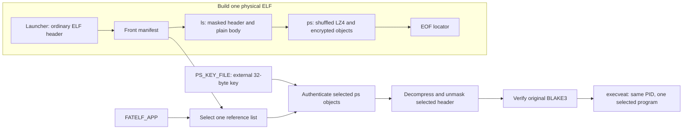

# Binary analysis: ls and ps

Measured on 2026-10-04 on x86_64 Linux with Rust 1.99.0, static musl launchers,
fixed 4096-byte chunking, dedup enabled, seed 42, and only `ps` shuffle-eligible.
Inputs are the host’s dynamically linked `/usr/bin/ls` and `/usr/bin/ps`.
Each reported container was built, executed against native stdout, and extracted
back to both exact original files. These are file sizes, not RSS or startup benchmarks.

## Baseline sizes before the compact-hash pass

| Input / baseline | Bytes | KiB |
|---|---:|---:|
| `ls` | 153,400 | 149.8 |
| `ps` | 124,712 | 121.8 |
| Inputs added directly | 278,112 | 271.6 |
| Old static launcher | 981,504 | 958.5 |
| Old optimized combined v1 | 1,262,380 | 1,232.8 |

| Runtime profile | Bytes | Difference from core |
|---|---:|---:|
| `core` | 521,208 | +0 |
| `compression` | 524,688 | +3,480 |
| `encryption` | 549,400 | +28,192 |
| `full` | 553,224 | +32,016 |

The core launcher shrank **46.9%**; the full launcher shrank **43.6%** relative
to the old launcher. The runtime no longer installs `color-eyre` and its external
backtrace/reporting stack, and excludes builder/TUI/TOML/CLI dependencies. Its
dedicated profile uses size optimization, full LTO, one codegen unit and aborting
panics. Removal and optimization were measured together; individual savings were
not isolated. `size` reports 503,779 text/read-only bytes for core and 534,255 for
full. Rust std, JSON decoding, hashing, Linux execution and allocation still cost
space. Later symbol attribution and additional reductions appear below.

| Container | Backend / manifest | Launcher | Stored pool | Manifest | Total bytes | Smaller than v1 |
|---|---|---:|---:|---:|---:|---:|
| `raw-end` | memfd / end | 521,208 | 278,112 | 7,243 | **806,627** | 36.1% |
| `raw-full` | memfd / end | 553,224 | 278,112 | 7,243 | **838,643** | 33.6% |
| `lz4-end` | memfd / end | 524,688 | 180,006 | 7,653 | **712,411** | 43.6% |
| `lz4-front` | file / front | 524,688 | 180,006 | 7,654 | **712,412** | 43.6% |
| `ps-lz4-front` | memfd / front | 524,688 | 230,022 | 7,436 | **762,210** | 39.6% |
| `ps-encrypted-front` | file / front | 553,224 | 230,534 | 10,188 | **794,010** | 37.1% |
| `ps-encrypted-end` | memfd / end | 553,224 | 230,534 | 10,187 | **794,009** | 37.1% |
| `ps-encrypted-raw` | memfd / end | 549,400 | 278,624 | 9,996 | **838,084** | 33.6% |

Each total also includes the 64-byte footer. `raw-end` uses the minimal core;
`raw-full` isolates the extra decoder cost. `lz4-*` compress both programs;
`ps-lz4-front` and `ps-encrypted-*` leave `ls`’s body plain.
`ps-encrypted-raw` disables compression and uses the encryption-only launcher.
Front/end comparisons also change backend here, accounting for tiny JSON length
differences; they do not reserve extra padding.

Deduplication saves **zero stored bytes** for these particular two executables.
The raw pool remains their exact combined length. Compressing both reduces pool
bytes from 278,112 to 180,006 (**35.3%**). Compressing only `ps` gives 230,022 bytes.
Encrypting its 32 unique objects adds exactly **512 tag bytes**, yielding 230,534.
The full encrypted container adds 31,800 bytes over `ps-lz4-front`: 28,536 of
launcher code, 512 of tags, and 2,752 of metadata. Fresh ciphertext differs between
builds, but fixed-width nonce metadata makes predicted sizes exact.

The smallest example is still **2.56×** the original inputs added together.
Packaging two small existing tools is mainly a deployment/selection convenience;
a general Rust runtime can cost more than compression saves. Metadata also grew
from 2,700 bytes in v1 to 7,243 in raw v2 because descriptors now record transform
and decoded-size details, budgets and complete header references. There are 71
objects instead of v1’s 69 because each header is now a separate mandatory object.

## What is actually inside

```text
ps-encrypted-front: 794,010 bytes
[0..553,224)       normal static launcher ELF
[553,224..563,412) readable JSON manifest: 10,188 bytes
[563,412..793,946) stored object pool: 230,534 bytes
[793,946..794,010) fixed RSL locator: 64 bytes
```



Objects for `ps` are physically permuted; that diagram is conceptual, not a claim
that its logical header/body order remains adjacent. `ls` stays an ordered anchor.
The original section/program header structures are restored byte-for-byte; the
kernel and ordinary dynamic loader handle the selected ELF. Payloads are never
linked together or loaded concurrently. The launcher reads the overlay itself;
the appended manifest/pool are outside the launcher’s ELF LOAD segments.

`file` sees a stripped statically linked x86_64 ELF; `readelf` shows the launcher’s
nine program headers and its entrypoint. Neither sees a second deliberately
stored ELF header. The sample launcher is `ET_EXEC` with fixed text addresses;
launcher PIE hardening was not added. The selected PIE executable regains its
normal kernel loading and ASLR behavior after replacement.

The first bytes of a raw masked header are `da e0 e9 e3 a7 a4 a4 a5`, rather than
`7f 45 4c 46 02 01 01 00`. All 52/64 header bytes are masked, not just the magic.
When compressed/encrypted, that stored prefix changes further. Runtime checks
the restored class and canonical size independently before writing the header.

| Image | Literal ELF magic offsets | Plausible complete ELF header offsets |
|---|---|---|
| `raw-end` | 0, 186611, 186718, 266645 | 0 |
| `ps-encrypted-front` | 0, 205505, 205612, 296949 | 0 |

An independent byte scan required valid class/data/version and matching declared
header size; it found a plausible header **only at offset 0** in all eight samples.
Other literal matches fall inside launcher code/constants. This is sample evidence,
not a promise that arbitrary programs or random ciphertext contain no accidental
magic. Public XOR, readable `FATELF02` and JSON metadata make the format identifiable.

## Reproduce the walkthroughs

The measurement artifacts and keys lived under ignored `target/` directories.
A fresh checkout includes the recordings and the scripts to build equivalent
examples. Start with the [walkthrough](tutorial.md), or run the
[recording script](tutorial/demos/README.md) for either backend. Sizes, process
names, and timings depend on the host inputs and toolchain.

## Strengths and weaknesses

| Property | Strength | Limit / issue to anticipate |
|---|---|---|
| Native execution | Kernel loads the exact original ELF; PID/status/signals preserved. | Host interpreter, libraries, `/proc`, ABI and resources remain required. `argv[0]` names the bundle; pathname/$ORIGIN-sensitive programs can differ. |
| Single file | Packaged programs need no originals at launch. | Overlay bytes must survive strip/objcopy/signing/repacking tools; rewriting or truncating them breaks the locator. |
| Header concealment | Every deliberately stored original header is obscured. | XOR is public and reversible; first-program body strings/instructions remain visible. Arbitrary embedded ELF data may remain recognizable. |
| Scoped policies | Global/payload/section/range decisions are validated before publication. | A region override can intentionally leave sensitive bytes unencrypted. Inspect plan counts/policies; conflicts and header splits are rejected. |
| Encryption | External keys protect stored encrypted bytes; AEAD checks precede decompression. | Names, sizes, hashes, references, key IDs and routing remain readable. Public digests can identify known binaries; dedup reveals repetition. Metadata encryption is later. |
| Integrity | Ciphertext and exact manifest changes fail when encrypted objects decode. | Outer launcher/routing are unsigned. Replacement can change code, choose plaintext, or replace encrypted objects with a plaintext program and recomputed public metadata. This is not trusted-container execution. |
| Runtime keys | Only selected keys are read; all declared key-source variables are stripped. | Files only; no provider/FD keys or secret delivery yet. Key rotation needs re-encryption and a new build. |
| Plaintext handling | Memfd avoids named runtime payload files; file output is unlinked before decoding. | Selected bytes remain accessible to permitted debuggers/proc readers. File backend and encoded build spool can leave recoverable plaintext on storage; swap/host protections are separate. |
| Resource bounds | Object decode and manifest/config/spool budgets are enforced. | Memfd still holds the entire selected executable in kernel memory; launch buffers are bounded, not total payload/process RSS. Packing reads one whole bounded original at a time. |
| Size/sharing | LZ4 reduces this pool 35.3%; identical inputs can share exactly. | Fixed runtime cost dominates tiny programs. These ls/ps binaries share no compatible fixed chunks. More codecs/layouts may trade size, startup cost and compatibility. |
| Reproducibility | Unencrypted containers reproduce with fixed inputs/settings. | Encryption uses fresh OS randomness; reproducible encrypted mode is deferred and must never reuse seeded ordinary AEAD nonces. |
| Extensibility | Codec preparation/decoding, policy resolution and pool placement are separated. | One layout strategy/two placements, one compression codec, one AEAD; no arbitrary recipes/plugin engine or custom ELF loader. |

## Verification performed

- `just ci`: exit 0; fmt, all-target/all-feature clippy, **44 tests**, cargo-deny.
  RustSec advisory database refreshed beforehand; only allowed duplicate-version
  warnings for hashbrown/syn remained.
- Minimal core, compression-only and encryption-only launcher clippy: exit 0.
- `just release`: exit 0; unsigned static musl packer/full launcher, plus separately
  built core/LZ4/encryption profiles. Zig emitted a nonfatal deprecated linker
  optimization warning for the packer.
- Eight ls/ps profiles: exact plan size, native stdout and exact original extraction;
  front/end, memfd/file, selective shuffle and encrypted/unencrypted execution.
- Missing/wrong keys, repaired-manifest tampering, corrupt body/header, malformed
  LZ4, budget violations and no-output-on-failure covered by focused/acceptance tests.
- 64 payloads: every label executed; identical `/usr/bin/true` inputs stored once.
  One/three payload behavior is also covered by config acceptance tests.
- 80×24 real PTY: F6 saved an advanced encrypted TOML, restored the terminal, built
  it, and its ps variant executed with the external key.
- `just fuzz`: **975,140** container/codec executions in 61 seconds, exit 0.
  `just fuzz-config`: **2,008,826** executions in 61 seconds, exit 0. New v2 seeds
  exercised both positions and LZ4; no crashes in these smoke runs.
- Recorder Bash/ShellCheck/Python checks and local cast assertions passed; GIF
  frames viewed with `view_image` show ls, ps, key denial and successful unlock.

Not established: AArch64 execution, cold-start/RSS benchmarks, stable format
compatibility, signatures/global authenticated routing, arbitrary custom layouts,
providers/pre-flight checks, encrypted secrets/metadata, and reproducible encryption.
Those remain explicit later work rather than implied capabilities of these builds.

## Launcher optimization pass

The current x86_64 recipes use `opt-level="s"` and enable `compact-hash`, which
selects BLAKE3's Rust SIMD intrinsics instead of native assembly/AVX-512. Builder
defaults retain native hashing. Neither the v2 format nor its digest/AEAD semantics
changed. The first tables above preserve the earlier baseline.

| Shipping launcher | Previous bytes | Current bytes | Saved |
|---|---:|---:|---:|
| Core | 521,208 | **488,832** | 32,376 (6.2%) |
| Compression | 524,688 | **491,024** | 33,664 (6.4%) |
| Encryption | 549,400 | **517,536** | 31,864 (5.8%) |
| Full | 553,224 | **519,672** | 33,552 (6.1%) |

| Rebuilt container | Previous bytes | Current bytes | Stored pool |
|---|---:|---:|---:|
| `raw-end` | 806,627 | **774,251** | 278,112 |
| `raw-full` | 838,643 | **805,091** | 278,112 |
| `lz4-end` | 712,411 | **678,747** | 180,006 |
| `lz4-front` | 712,412 | **678,748** | 180,006 |
| `ps-lz4-front` | 762,210 | **728,546** | 230,022 |
| `ps-encrypted-front` | 794,010 | **760,458** | 230,534 |
| `ps-encrypted-end` | 794,009 | **760,457** | 230,534 |
| `ps-encrypted-raw` | 838,084 | **806,220** | 278,624 |

The smallest bundle is now 2.44× the 278,112-byte input sum, and 46.2% smaller
than the 1,262,380-byte v1 baseline. The stored pool and metadata have the same
sizes as before; all savings in these comparisons come from the launcher.

### What the dependency measurements support

An unstripped, auditable core build with the former launcher settings was read
with `nm -S --size-sort --demangle`. Symbol-name groups are attribution estimates:
inlining hides some dependency work inside callers, and these totals are not
independent predictions of how many file bytes removal would save.

| Baseline symbol group | Identified text bytes | Decision |
|---|---:|---|
| Rust std panic/backtrace, gimli, addr2line, demangling and inflate | 167,437 | Largest fixed cost; no supported removal switch in pinned stable Rust. |
| BLAKE3 | 72,975 | Use its existing pure-Rust feature, retaining SIMD. |
| serde/JSON | 28,027 | Keep validated v2 decoding; a binary manifest would require another format version. |
| tempfile/random | 3,718 | Keep race-resistant creation/cleanup; manual replacement has little measured upside. |
| bnb | 738 | Already small; retain RSL for the binary footer. |
| object header parsing | 42 | Keep the existing ELF validation; most builder ELF machinery is already absent. |

Controlled core experiments used the same auditable build, disabled compiler
stripping, then applied GNU `strip --strip-all` to each result. Their file sizes
are not the shipping table: audit records and stripping paths differ slightly.

| Experiment | Stripped bytes | Finding |
|---|---:|---|
| Previous settings: native BLAKE3, `z`, fat LTO | 521,592 | Control |
| BLAKE3 `pure`, `z`, fat LTO | 496,032 | Saves 25,560 bytes. |
| `pure` plus all SIMD-disable flags, `z` | 495,712 | Only 320 further bytes; rejects a useful speed optimization. |
| `pure`, `s`, fat LTO | 488,848 | Saves another 7,184 bytes; chosen. |
| `pure`, `z`, thin LTO | 573,296 | Larger; rejected. |
| `pure`, `s`, forced LLVM machine outlining | 493,440 | Larger despite 637 outlined functions; rejected. |

Disabling BLAKE3's detection paths does not remove all its enum-dispatch SIMD
implementations from this optimized image. Its `pure` feature does omit native
AVX-512 code and lets LLVM optimize the remaining Rust implementations for size.
LZ4 adds only 2,192 shipping bytes above current core; handwritten decompression
would exchange existing checked decoding for little size reduction. Keep vetted
AEAD implementations rather than writing cryptography to chase code size.

`panic=immediate-abort` was tested and rejected by Rust 1.99.0 without nightly
unstable options. Ordinary `panic="abort"` still retains std's default panic hook
and its backtrace branch; installing another hook does not remove that branch.
Substantial removal needs a separate `no_std` runtime or another launcher language,
rather than undocumented linker overrides or a compiler-bootstrap workaround.

### Startup tradeoff

Measured on this host's AMD Ryzen Threadripper 7970X, with 100 successful launches
per variant, 10 warmups, CPU affinity 0, warm filesystem cache and seeded interleaved
order. Timing includes Python subprocess creation, full reconstruction/verification
and execution; stdout was redirected to `/dev/null`, exit status was checked.
This is an end-to-end comparison of the controlled core builds, not a standalone
hash-throughput or cold-start benchmark.

| Selected input | Native/`z` median ± MAD | Rust SIMD/`s` median ± MAD |
|---|---:|---:|
| `/usr/bin/true` | 0.845 ± 0.061 ms | 0.878 ± 0.043 ms |
| `/usr/bin/ls -1` | 1.520 ± 0.088 ms | 1.541 ± 0.072 ms |
| `true` with 8 MiB of appended zero bytes, stored without dedup/compression | 15.355 ± 0.273 ms | 17.231 ± 0.323 ms |

The small-input differences are below their run-to-run dispersion. The synthetic
large input shows a measurable **12.2%** launch regression on this AVX-512 host.
Choose the documented native-hash build for large inputs where that tradeoff is
unacceptable. Other target recipes do not automatically enable `compact-hash`;
AArch64's `pure`/NEON size and performance tradeoff has not been measured.
Raw samples were recorded in `target/launcher-optimization/startup-experiments.json`
on the measurement host.

### Compact-build verification

All eight compact bundles were rebuilt and run against native ls/ps stdout,
then both originals were extracted and compared byte-for-byte. Each actual file
size equals its plan. Keyless ls and missing-key ps behavior, both execution
backends, front/end placement and masked source headers were checked; the independent
scanner again found a plausible complete ELF header only at offset 0. The launcher optimization changed symbol offsets. Raw magic positions were
recorded in the local measurements. The tutorial recordings show the release
version and measurements from their own recording host.
For this pass, `just ci` passed all 44 tests plus format/clippy/cargo-deny;
minimal compact core/compression/encryption clippy and `just release` also exited 0.
RustSec was refreshed before release. Fuzz targets were not rerun because this
change only selects existing library implementations and build optimization settings.

### MVP workload spot check

An x86-64 Linux spot check bundled the system Git and ripgrep executables with
LZ4. The 7.62 MB bundle held 9.51 MB of original executable bytes, and both
backends matched native output for `git hash-object` and a ripgrep search.
Across 20 runs per command and mode on one host, median startup plus work was
16–18 ms for warm-cache bundles and 19–21 ms after asking Linux to evict the
bundle's file pages. Native medians were 1–2 ms warm and 4–5 ms after the same
request on copied executables with their original basenames. This was a
local spot check under concurrent load. The file-page eviction request does
not evict the system loader or shared libraries. Measure latency and storage
use on deployment hosts before bundling short-lived, frequently invoked tools.

### A separate launcher language

The existing explicit-launcher seam can support a future standalone backend:

```toml
# Proposed artifact, not an implemented backend yet:
launcher = "/full/path/fatelf-launcher-zig"
```

Rust would still own CLI, TUI, TOML, ELF planning, transforms, deduplication and
writing the container with bnb. Another language would read the same documented
format, apply equivalent bounds/authentication/reconstruction and execute one
payload. An independent executable avoids an FFI interface to Rust runtime code,
which could retain the std cost we are trying to remove.

Zig is the first candidate because its compiler is already our cross-linking
tool and its installed standard library supplies BLAKE3 and XChaCha20-Poly1305.
[Zig supports cross-compilation directly](https://ziglang.org/learn/overview/#cross-compiling-is-a-first-class-use-case).
Odin is also viable: its official libraries include
[JSON](https://pkg.odin-lang.org/core/encoding/json/),
[XChaCha20-Poly1305](https://pkg.odin-lang.org/core/crypto/chacha20poly1305/) and
[LZ4 bindings](https://pkg.odin-lang.org/vendor/). Its documented core/vendor
catalogs currently do not list BLAKE3, so our current format would need an added
implementation or binding. Neither candidate has been implemented or size-benchmarked
here; this is an integration recommendation, not a claim that Zig outperforms Odin.

Both trade Rust's ownership checks for programmer-managed lifetimes. Zig's
[`ReleaseSmall` disables runtime safety by default](https://ziglang.org/documentation/0.16.0/#Build-Mode):
an input-handling prototype must preserve explicit overflow/bounds checks and
appropriate safety checks. [Odin also uses manual memory management](https://odin-lang.org/docs/overview/#allocators).
Either split adds format/model duplication, compiler pinning, dependency audit
and fuzz/sanitizer work. Promotion should require differential tests against Rust
for valid and malformed containers, hash/AEAD vectors, raw argument/environment
and descriptor behavior, and comparable full-feature size/startup measurements.
