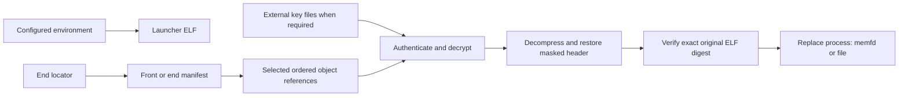

# Fatelf v2 container format

```text
front: [launcher ELF][JSON manifest][stored object pool][64-byte locator]
end:   [launcher ELF][stored object pool][JSON manifest][64-byte locator]
```



Front means **after the complete launcher**, preserving the outer ELF entrypoint.
Pool offsets are relative to the object region, so front metadata creates no
JSON-offset length feedback or reserved padding. Intervals cover the pool exactly
once; payload references may share/repeat body objects.

The footer is encoded/decoded by RSL
[`bitsandbytes` 0.7.1](https://crates.io/crates/bitsandbytes/0.7.1), imported as
`bnb`. `object` validates ELF inputs, section locations, and restored header
class/byte order/canonical size. No handwritten ELF loader or relocation engine
is present. Compression uses `lz4_flex` 0.14.0 bounded block APIs; encryption uses
RustCrypto `chacha20poly1305` 0.11.0.

| Footer offset | Bytes | Meaning |
|---|---|---|
| 0 | 8 | ASCII `FATELF02` |
| 8 | 8 | Complete launcher length, little-endian u64 |
| 16 | 8 | Absolute manifest start, little-endian u64 |
| 24 | 8 | Manifest length, little-endian u64 |
| 32 | 32 | BLAKE3 of exact serialized manifest bytes |

The strict JSON manifest contains version, selection/default, backend, manifest
position, budgets, runtime key references, unique `chunks`, and `payloads`.
Each chunk has pool-relative `offset`, stored `length`, `decoded_length`, actual
`codec` (`raw`/`lz4-block`), `encoding`, and optional encryption key ID/48-character
nonce. Each payload has name, original length, `header_length`, BLAKE3 hex hash,
and ordered chunk indices. Its first reference is exactly one masked 52/64-byte
ELF header. Body references use `identity`, `xor-a5`, or `xor-mask`.
Noncanonical header extensions are rejected. `inspect` reports placement and object statistics.

The header and `xor-a5` encodings apply the public byte mask `0xA5`.
The `xor-mask` encoding repeats the public manifest `xor_mask` array (1–32
bytes), starting at its first byte for every object. The array is required
when any object uses `xor-mask` and otherwise omitted. Encoding precedes compression
and AEAD. Raw fallback retains the source encoding. Decode authenticates first,
decompresses into an exact bounded buffer, reverses the source encoding, validates
the header, and verifies the original digest before execution/publication. AEAD associated
data is exactly 57 bytes: the 17-byte ASCII domain `fatelf-v2-object\0`
(including the terminating NUL), the 32 manifest-hash bytes from the footer,
and the zero-based index in `manifest.chunks` as a little-endian u64.
The stored object is XChaCha20-Poly1305 ciphertext followed by its 16-byte
authentication tag. The recorded object length includes the tag.
Nonces/lengths/offsets are finalized before encryption; ciphertext tags are not
manifest fields, avoiding a circular commitment.

Payload XOR is an opt-in v2 encoding extension. Builders require an ELF
`.fatelf.xor` section containing exactly the eight ASCII bytes `FATXOR01` when
writing `xor-a5` objects. For `xor-mask` objects, builders require
`.fatelf.xormask` containing `FATXOR02`. These markers preserve the original
`.fatelf` descriptor. A reader without the corresponding extension rejects
that encoding. New readers also accept earlier v2 bundles.

**Version break:** TOML schema and container format are independently version 2.
v1 configs/readers are unsupported; existing standalone v1 executables retain
their own old launcher. Compatibility policy is documented in the [release procedure](release/README.md).

See [configuration limits](configuration.md#resource-limits) for the bounds readers enforce.
