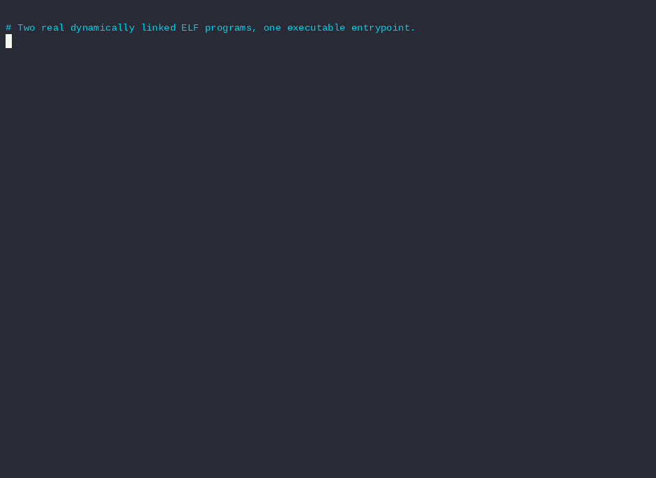

# Pack ls and ps into one ELF

One executable contains `/usr/bin/ls` and `/usr/bin/ps`; `FATELF_APP` selects the
original program. An unset selector runs `ls`, and arguments pass through.
These v2 examples use a small static launcher around dynamically linked x86-64
PIE payloads. Their interpreter, shared libraries and resources still come from
the host.

Both embedded ELF headers receive the mandatory public reversible mask. The
first example shuffles only `ps`; the second also compresses and encrypts `ps`
with an external key while leaving the `ls` body plain.

## 1. Build the small release launcher and pack

Run from this repository on a compatible Linux host with `/usr/bin/ls`,
`/usr/bin/ps`, their libraries, and `/proc` available. The release recipe requires
this repository's configured Rust, musl, Zig and cargo build tooling.
The examples use standalone GNU `ls`. On hosts with a multicall implementation
of `ls`, follow the [quickstart](../README.md#pack-run-and-verify) with Bash
and `ps`.

```bash
set -euo pipefail
just release
fatelf_bin="$(pwd -P)/target/x86_64-unknown-linux-musl/release"
demo_dir=$(mktemp -d)
mkdir "$demo_dir/samples"
touch "$demo_dir/samples/alpha.txt" "$demo_dir/samples/beta.txt"

"$fatelf_bin/fatelf" pack ls=/usr/bin/ls ps=/usr/bin/ps \
  -o "$demo_dir/combined" \
  --select-env FATELF_APP --default ls --exec memfd \
  --order shuffled --shuffle-payload ps --seed 42 --dedup \
  --manifest-position end

stat -c '%n %s bytes' /usr/bin/ls /usr/bin/ps "$demo_dir/combined"
"$fatelf_bin/fatelf" inspect "$demo_dir/combined"
```

The packer uses its adjacent launcher. Inputs must match that launcher's
architecture and byte order. The new output path is never overwritten.
`manifest-position=end` stores `[launcher][object pool][manifest][footer]`;
`front` stores `[launcher][manifest][object pool][footer]`. Neither puts metadata
before the outer executable's ELF header.



[Play the cast](tutorial/demos/01-ls-ps-memfd.cast).

## 2. Select either program from the same entrypoint

```bash
# No selector: the configured default is ls.
env -u FATELF_APP "$demo_dir/combined" -1 "$demo_dir/samples"

# Explicit ls selection.
FATELF_APP=ls "$demo_dir/combined" -1 "$demo_dir/samples"

# The identical executable path now launches ps.
FATELF_APP=ps "$demo_dir/combined" -p 1 -o pid,comm
```

The `ls` commands list `alpha.txt` and `beta.txt`; `ps` prints PID/COMMAND for
PID 1. The process name depends on the host. Empty or unknown selector values
fail. `argv[0]` remains the combined path.

## 3. Recover and compare the original bytes

```bash
"$fatelf_bin/fatelf" extract "$demo_dir/combined" --variant ls \
  -o "$demo_dir/recovered-ls"
"$fatelf_bin/fatelf" extract "$demo_dir/combined" --variant ps \
  -o "$demo_dir/recovered-ps"
cmp /usr/bin/ls "$demo_dir/recovered-ls"
cmp /usr/bin/ps "$demo_dir/recovered-ps"
```

Successful `cmp` calls produce no output. The launcher checks the reconstructed
payload's digest before executing it. Shuffling and header masking provide
layout obfuscation; their reversal requires no secret.

## 4. Encrypt only ps, with a front manifest and file execution

Create a private random key and an absolute-path TOML file. Python quotes paths
so spaces, quotes and backslashes do not change TOML syntax. The key file holds
exactly 32 raw bytes; the configuration and runtime environment contain its
reference, never its value.

```bash
config_dir=$(mktemp -d)
export FATELF_GUIDE_BIN="$fatelf_bin" FATELF_GUIDE_DIR="$config_dir"
python3 - <<'PY'
import json, os, pathlib
bin_dir = pathlib.Path(os.environ["FATELF_GUIDE_BIN"])
base = pathlib.Path(os.environ["FATELF_GUIDE_DIR"])
quote = lambda value: json.dumps(str(value), ensure_ascii=False)
key = base / "ps.key"
with os.fdopen(os.open(key, os.O_WRONLY | os.O_CREAT | os.O_EXCL, 0o600), "wb") as output:
    output.write(os.urandom(32))
(base / "bundle.toml").write_text(f'''version = 2
output = {quote(base / "combined")}
launcher = {quote(bin_dir / "fatelf-launcher")}

[[keys]]
name = "ps"
key_file = {quote(key)}
env = "PS_KEY_FILE"

[[payloads]]
name = "ls"
path = "/usr/bin/ls"
shuffle = false
compression = "none"

[[payloads]]
name = "ps"
path = "/usr/bin/ps"
shuffle = true
compression = "lz4"
encryption = "ps"

[selection]
env = "FATELF_APP"
default = "ls"

[storage]
layout = "overlay"
manifest_position = "front"
order = "shuffled"
dedup = true
seed = 42

[execution]
backend = "file"
''')
PY

"$fatelf_bin/fatelf" plan --config "$config_dir/bundle.toml"
"$fatelf_bin/fatelf" build --config "$config_dir/bundle.toml"

# ls runs without unlocking ps.
env -u PS_KEY_FILE FATELF_APP=ls "$config_dir/combined" -1 "$demo_dir/samples"

# Missing ps key is a checked, expected failure.
if env -u PS_KEY_FILE FATELF_APP=ps "$config_dir/combined" -p 1 -o pid,comm; then
  printf 'ERROR: encrypted ps launched without its key\n' >&2
  exit 1
else
  printf 'Expected: encrypted ps denied without PS_KEY_FILE\n'
fi

# Supply the external key file reference; ps now runs.
PS_KEY_FILE="$config_dir/ps.key" FATELF_APP=ps \
  "$config_dir/combined" -p 1 -o pid,comm

# Recovery uses the same external key reference.
PS_KEY_FILE="$config_dir/ps.key" "$fatelf_bin/fatelf" extract \
  "$config_dir/combined" --variant ps -o "$config_dir/recovered-ps"
cmp /usr/bin/ps "$config_dir/recovered-ps"
```

`plan` validates and reports sizes without publishing the combined executable.
LZ4 operates per object and keeps raw storage when compression would grow it.
Encrypted objects use fresh XChaCha20-Poly1305 nonces; their authentication binds
both the object identity and the exact manifest. Encrypted builds therefore
produce different bytes while retaining the planned size.


[Play the cast](tutorial/demos/02-ls-ps-toml-file.cast). The TUI uses the same
configuration: `fatelf configure --config /full/path/bundle.toml`; F6 saves TOML,
restores the terminal and runs `build --config`. Basic fields include compression,
manifest position, and each payload's shuffle/key selection. Advanced region
rules, key definitions and budgets are edited in TOML and preserved by the TUI.

Keep the key separate from the container. Unlock variables are removed from
the launched program's environment. The manifest remains readable, including
payload labels, routing variable names, object boundaries and key reference
names. Authentication of encrypted objects does not authenticate a modified
outer launcher; publisher signatures and encrypted metadata are future work.
Plaintext becomes available to the launcher and selected program after unlocking.

`memfd` requires host permission for executable memory-backed files. `file`
reconstructs into private filesystem storage and unlinks it before execution;
`TMPDIR` selects that storage and its mount must allow execution. Neither backend
bundles libraries or adapts original pathname-relative resources. Do not run
`strip` or another ELF postprocessor on a finished container: appended regions
must remain intact. Keep generated executables and key files out of version
control. See the [binary analysis](binary-analysis.md) for measured sizes and limits.

## Replay or regenerate

```bash
asciinema play docs/tutorial/demos/01-ls-ps-memfd.cast
asciinema play docs/tutorial/demos/02-ls-ps-toml-file.cast
just demo
just record-demo
```

See [recording dependencies and controls](tutorial/demos/README.md). Recording
and rendering stay local; regenerate after changing these workflows.
